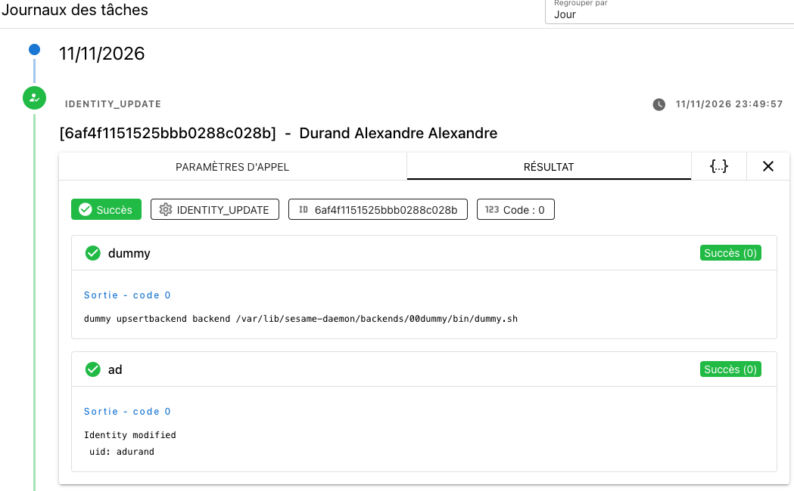

# Release 2.4.1
Ceci est une release mineure
## Mise à jour
Pour rappel la mise à jour se fait : 
* soit 
```
#make sesame-update
```
* ou 
```shell
#docker compose pull
#docker compose up -d
```

## Liste des changements
### Amélioration de la visibilité des journaux. 
Il est possible maintenant d'inclure des retours à la ligne dans les journaux. L'affichage des tâches a été revu pour pouvoir prendre en compte les retours à la ligne 



Vous pouvez toujours avoir la sortie JSON sur la tab **"{...}"**

#### Formatage du json de retour par les backends 
Le backend doit envoyer literalement "\n" dans son retour 

Exemple en Shell : 
```
#!/bin/sh
JSON=`cat -`
echo "{\"status\": 0, \"message\": \"dummy upsertbackend backend $0 " '\\n test' '\\n test2' '\\n test3' "\"}"
exit 0
```

Exemple en PowerShell (pour le backend AD)
```
 Write-Host "Identity modified \n uid: {{ e.uid }}"
```

